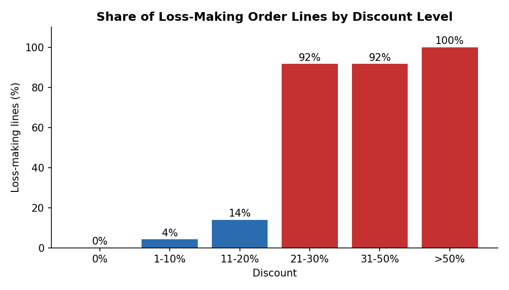

# Superstore Sales: Profit and Loss Analysis (Python)

## Business question
Which orders lose money, and what drives those losses?

## Dataset
Superstore sales data from Kaggle: 9,994 order lines, 21 columns (orders, customers, products, discounts, sales, profit).

## What I did
1. **Cleaned the data:** removed 1 duplicate (9,993 rows left), checked dates (0 invalid, 0 shipped before ordered) and flagged 32 product IDs that have more than one product name.
2. **KPI analysis:** sales, profit, margin, loss rate, and breakdowns by year, category, region, segment, sub-category and discount level.
3. **Classification:** Logistic Regression and Decision Tree to predict whether an order line is loss-making, with a stratified train/test split and 5-fold cross-validation.
4. **Charts:** monthly sales and profit, profit by sub-category, loss rate by discount level, feature importance.

## Key results
- 5,009 orders, 793 customers, 1,862 products.
- Total sales 2,296,919.49 and total profit 286,409.08 (margin 12.47%).
- 1,870 order lines (18.71%) were loss-making, with a total loss of 156,119.23.
- Discount and profit are negatively correlated (-0.219).
- The share of loss-making lines is 0% at no discount, 4% at 1-10%, 14% at 11-20%, then 92% at 21-30%, 92% at 31-50% and 100% above 50%.
- Tables, Bookcases and Supplies were the loss-making sub-categories.

## Model results (1,999 test records)
| Model | Accuracy | Precision | Recall | F1 | ROC AUC | 5-fold CV accuracy |
|---|---|---|---|---|---|---|
| Logistic Regression | 0.949 | 0.922 | 0.794 | 0.853 | 0.984 | 0.944 |
| Decision Tree | 0.946 | 0.908 | 0.791 | 0.846 | 0.983 | 0.948 |

Baseline accuracy (always predicting "profitable"): 0.813.
The decision tree's most important feature is Discount (0.881).

## Recommendation
Cap discounts at around 20%. Above that level almost every order line loses money. Review pricing and discounting for Tables, Bookcases and Supplies first.

## Limitations
- Recall is about 79%, so the models miss roughly 1 in 5 loss-making lines.
- Discount dominates the model, so it does not explain losses at low discounts.

## Tools
Python, Pandas, NumPy, Matplotlib, scikit-learn, Google Colab.

## How to run
Upload `Superstore.csv` next to the notebook and run all cells. Outputs are saved in `outputs/`.

## Files
- `superstore-sales.ipynb`: the full analysis
- `fig1` to `fig4` (PNG files): the 4 charts
- `superstore_cleaned.csv`: the cleaned dataset
